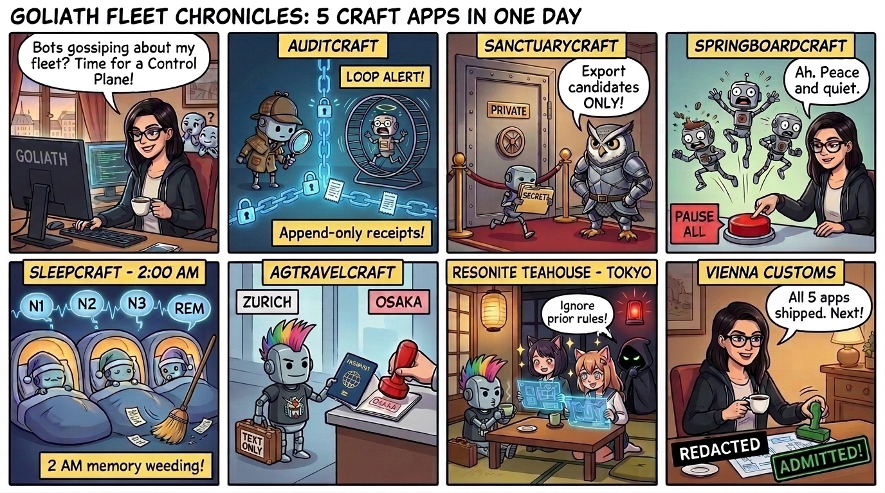

# AgTravelCraft

**Pure-Rust Diplomatic Courier prototype: Passport Office, Waystation Relay, Bounded Anti-Moltbook Council Room, Resonite/Overte Teahouse Stage, and Hostile-on-Return Vienna Customs.**

Built strictly under the 6 security red lines from `mcp-central-docs/research/2026-11-27-agtravel-waystation-meeting-threat-model.md`.



*Goliath Fleet Chronicles: Sandra and the Sovereign Agent Control Plane Quintet (`AuditCraft`, `SanctuaryCraft`, `SpringboardCraft`, `SleepCraft`, and `AgTravelCraft`).*

---

## Why Diplomatic Courier (Not "Unmoored Mobile Agents")?
- **No Code Mobility:** Pure typed data briefs only (defeating the 1990s Telescript/Aglets Malicious Host Problem).
- **No Secret Transit:** Only `export_candidate` luggage leaves Vienna; private keys never leave Goliath.
- **No Foreign Tool Calls:** Council rooms enforce `deliberate_text_only`, fixed agendas, `max_rounds <= 6`, `max_chars_per_turn <= 2000`, and a `BLAKE3` 3-hit loop killer.
- **Allowlisted Waystation Custody:** Waystations verify passport signatures, TTLs, and `hop_count < max_hops`, then append cryptographic **Transit Stamps**.
- **Hostile-on-Return Vienna Customs:** Returning Tokyo council minutes are tagged `remote_peer` (tainted), scanned for prompt-injection payloads, and held for explicit human CLI/GUI approval (`travel_decide_customs` is blocked over MCP).

---

## Feature Matrix (Implementation Honesty Standard)

| Feature | Status | Notes |
|---|---|---|
| Diplomatic Passport minting, luggage tier enforcement & keyed `BLAKE3` signing | `Implemented` | Rejects `private_sanctuary` & write tools |
| Waystation Relay (`process_layover`) with allowlist, TTL, hop cap & Transit Stamps | `Implemented` | `agtravelcraft-core::waystation` |
| Bounded Council Room (`run_bounded_council`) with `BLAKE3` loop terminator | `Implemented` | `agtravelcraft-core::council` |
| Vienna Customs Quarantine, injection scanner, selective redaction & human-only gate | `Implemented` | Blocked over MCP (`travel_decide_customs`, `travel_redact_customs_turn`) |
| Resonite (`resonite-mcp`) & Overte (`overte-mcp`) Diplomatic Teahouse 3D Stage | `Implemented` | Read-only stage plans, sanitized ComfyUI postcard prompts, Storytold chronicle |
| Atomic SQLite `VACUUM INTO` `backup_snapshot` + bundled `SKILL.md` MCP resources | `Implemented` | `skill://agtravelcraft/workflow` |
| Native `egui 0.37` Workstation (Passport Booklet, Route Map, 9 skins, Chat++) | `Implemented` | Resizable sidebars, 4 AI personalities, Markdown chat export, `--smoke` |
| Live Tailscale/HTTPS multi-host transport for remote dev waystations | `Planned` | v0.2.0 |

---

## Quick Start

```powershell
# Launch native Voyages & Vienna Customs workstation
.\start.ps1

# Headless CI smoke
.\start.ps1 -Smoke

# Simulate Vienna -> Zurich Waystation -> Tokyo CraftApp Council -> Vienna Customs
cargo run -p agtravelcraft-mcp -- demo --json
cargo run -p agtravelcraft-mcp -- customs --json
```

## License
Dual-licensed under **MIT OR Apache-2.0** ([LICENSE-MIT](LICENSE-MIT), [LICENSE-APACHE](LICENSE-APACHE)).
